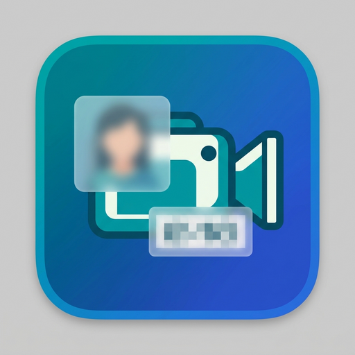

# Kdenlive Auto-Blur Tool



Detects, tracks and blurs **people and vehicles** in your footage – and puts the result straight
into your **Kdenlive project** as normal, editable tracking effects.

You cut your video in Kdenlive as usual, save the project, open it in this tool and press *Start*.
The tool finds the people and vehicles only in the parts of the video that are really used on the
timeline, and writes a **copy** of your project in which each of them has a pixelate/blur effect that
follows them. Open the copy in Kdenlive, check it, fix what you want by hand, render.

> **Please check the result.** Automatic detection is good but never perfect: people far away,
> partly hidden or in unusual poses can be missed. Always review the video before you publish it.

## Features

* **Works on your existing project.** Any number of clips and tracks, already cut and edited.
  Your project is never overwritten; the result is saved as `<name>_edited.kdenlive`.
* **Only analyses what is needed.** Parts of the source files that are not on the timeline are skipped.
* **Time range.** Process just a part of the timeline (for a quick test) or everything.
* **Stop and continue.** *Cancel & Save Progress* saves what is done so far; the tool then sets up
  the next run so you can continue from that timestamp later.
* **Native Kdenlive effects.** One tracking effect per detected object (`opencv.tracker`), cut into
  short blocks so the effect only exists where somebody is visible. Everything stays editable.
  Audio and picture of cut clips stay grouped.
* **Existing effects are respected.** Clips that already have a tracker effect are left alone
  (or redone, your choice), so your manual work is safe.
* **Live preview** with boxes, track IDs, timeline position, progress and time remaining.
* **Check video mode.** Alternatively, render a quick `.mkv` with the blur burned in (with the
  original audio) straight from a video file – handy for testing the detection settings.
* **Fast on Intel graphics** (OpenVINO), also runs on CPU and NVIDIA GPUs.
* Adjustable confidence, image size, blur type/strength, minimum object sizes, and more.

## Installation

### Easy way: packages

Download the file for your system from the **Releases** page.

| System | File | Install |
|---|---|---|
| Debian, Ubuntu, Mint… | `kdenlive-blur-gui_<version>_all.deb` | `sudo apt install ./kdenlive-blur-gui_<version>_all.deb` |
| Fedora | `kdenlive-blur-gui-<version>-1.fcXX.noarch.rpm` | `sudo dnf install ./kdenlive-blur-gui-<version>-1.fcXX.noarch.rpm` |
| Windows 10/11 | `kdenlive-blur-gui-setup-<version>.exe` | double-click (per-user, no admin rights needed) |

The packages are small. On the **first start** the tool notices that its Python components
(PyTorch, Ultralytics, OpenCV, …) are missing and offers to download them into a **private folder in
your home directory** – nothing is installed system-wide, you only need an internet connection once.
Download size: about 1 GB (CPU / Intel GPU) – a lot more for the NVIDIA option.

The installers also take care of the system parts: Python 3.10+, Tk (the window toolkit) and the
Python `venv` module. For the check-video mode `ffmpeg` is recommended.

### Manual installation (step by step)

Use this if you do not want the packages, or you are on another system. You need
**Python 3.10 or newer** with **Tk**, the **venv** module, and (only for the check video) **ffmpeg**.

#### 1. System components

**Debian / Ubuntu / Linux Mint**
```bash
sudo apt update
sudo apt install python3 python3-tk python3-venv ffmpeg git
```

**Fedora**
```bash
sudo dnf install python3 python3-tkinter ffmpeg-free git
# ffmpeg-free is enough for the check video. For the full ffmpeg enable RPM Fusion and install "ffmpeg" instead.
```

**Windows 10/11**
1. Install Python 3.12 from <https://www.python.org/downloads/> (or `winget install -e --id Python.Python.3.12`).
   Keep the options *tcl/tk and IDLE* and *py launcher* ticked.
2. For the check video: `winget install Gyan.FFmpeg`.

#### 2. Get the tool
```bash
git clone https://github.com/YOUR-USER/kdenlive-blur-gui.git
cd kdenlive-blur-gui
```
(or download the ZIP from GitHub and unpack it). The whole program is the single file `kdenlive_blur_gui.py`.

#### 3a. Start it – components are installed for you
```bash
python3 kdenlive_blur_gui.py        # Windows: py kdenlive_blur_gui.py
```
A window explains what is missing and offers to download it into a private environment
(`~/.local/share/kdenlive-blur-gui/venv`, on Windows `%LOCALAPPDATA%\KdenliveBlurApp\venv`).
Choose **CPU / Intel GPU** unless you have an NVIDIA card and know you want CUDA.
Afterwards the tool restarts itself inside that environment; from then on it just starts.

To repair or update that environment at any time: `python3 kdenlive_blur_gui.py --install-deps`.

#### 3b. Or install the components yourself
```bash
python3 -m venv ~/kdenlive-blur-venv
. ~/kdenlive-blur-venv/bin/activate              # Windows: kdenlive-blur-venv\Scripts\activate

# smaller CPU / Intel-GPU build of PyTorch (skip this line for the default build, e.g. NVIDIA on Linux):
pip install torch torchvision --index-url https://download.pytorch.org/whl/cpu

pip install -r requirements.txt
python kdenlive_blur_gui.py
```
For NVIDIA on Windows install the CUDA build of PyTorch first using the selector on
<https://pytorch.org/get-started/locally/>, then the last two lines.

> Why not the distribution's `python3-opencv`? Fedora's build cannot decode H.264/HEVC video
> (as produced by phones and action cameras). OpenCV from PyPI brings its own decoders.

#### 4. Intel graphics (optional, recommended on Intel hardware)
The default device `intel:gpu` uses OpenVINO. It needs the Intel compute runtime:
`sudo apt install intel-opencl-icd` (Debian/Ubuntu) or `sudo dnf install intel-compute-runtime` (Fedora);
package names can differ between releases. On the first run the model is converted automatically.
If it does not work for you, set **Execution Device (Hardware)** to `cpu` (or `cuda:0` for NVIDIA) in the *Advanced Configuration* tab.

The YOLO model file is downloaded automatically the first time it is needed, so the first run needs internet access.

## Using it

### Prepare in Kdenlive
1. Edit your video as usual: cut, arrange, add titles… Anything on the **video tracks** of the
   active sequence is analysed.
2. Save the project. Keep the original media files where Kdenlive found them
   (or tell the tool where they are, see *Media Folder*).

### Run the tool
1. **Mode** `kdenlive`, then **Browse…** and pick your `.kdenlive` file.
   The output name `<name>_edited.kdenlive` is suggested automatically.
2. *(optional)* **Media Folder** – only if the videos are not at the paths stored in the project
   (e.g. the project came from another computer). The tool then looks for the files by name there.
3. *(optional)* **Start / End time** – timeline time as `HH:MM:SS`, as shown in Kdenlive. Leave
   *Start* empty to begin at the start, leave *End* empty to continue to the end. A short range
   is the best way to try out your settings.
4. Choose **Target Mode** (`both`, `persons`, `vehicles`) and press **Start Processing & Generation**.
5. Open the `…_edited.kdenlive` file in Kdenlive, review, adjust, render.

While running, the status line shows the timeline position, the source file and time, and the speed.
The **Preview Interval** field (seconds, decimals allowed, `0` = off) controls how often the preview
image is updated; a lower value costs a little speed.

### Stop and continue later
Press the red **Cancel & Save Progress** button. The tool stops after the current frame, saves the project
with everything found so far, and prepares the next run: the saved project becomes the input and the
start time is set to where it stopped (the name counts up: `_edited2`, `_edited3`, …). Just press Start
again whenever you like.

### Existing tracker effects
*Advanced Configuration* tab → **Existing Tracker Effects**:
`keep` (default) leaves clips that already have a tracker effect completely untouched,
`replace` removes the old tracker effects of clips in the processed range and creates new ones.

### Check video (`mkv` mode)
Select **Mode** `mkv` and a normal video file. The tool renders a standalone `.mkv` with the blur burned in
and the original audio (needs `ffmpeg`). The time range fields then refer to the video's own time.
This mode does not touch any Kdenlive project.

### Dry run without the window
```bash
python3 kdenlive_blur_gui.py project.kdenlive [media_folder] [start] [end]
```
prints which parts of which files would be analysed, and how many frames that is.

## What the tool changes in your project

Only the clips on the **video tracks** and their grouped **audio** clips are touched:
a clip is split into pieces where somebody is detected, and each piece with detections gets one tracker
effect per object. The picture on the timeline is frame-for-frame the same as before; all other
tracks, transitions, effects, the project bin and other sequences stay as they are.
Clips with other effects on them are not split – the tracker effects are added on top of the whole clip.
Not handled (skipped with a note): clips with changed speed, nested sequences, title/colour clips,
and clips whose picture size differs from the project size (a warning is shown).

## Settings and files

| What | Linux | Windows |
|---|---|---|
| Settings (`settings.json`) | `~/.config/kdenlive_blur_gui/` | `%APPDATA%\KdenliveBlurApp\` |
| Downloaded Python components | `~/.local/share/kdenlive-blur-gui/venv` | `%LOCALAPPDATA%\KdenliveBlurApp\venv` |

**Uninstall:** remove the package (`sudo apt remove kdenlive-blur-gui` / `sudo dnf remove kdenlive-blur-gui` /
Windows *Apps & features*), then delete the two folders above if you want to get the space back.

## Troubleshooting

| Problem | What to do |
|---|---|
| "Python's Tk module is missing" | Debian/Ubuntu: `sudo apt install python3-tk` · Fedora: `sudo dnf install python3-tkinter` |
| "Could not create the Python environment" | Debian/Ubuntu: `sudo apt install python3-venv` |
| Download of components fails | Check the internet connection and start the tool again – it resumes. Details: `python3 kdenlive_blur_gui.py --install-deps` in a terminal. |
| pip finds no PyTorch for your Python | Your Python is newer than PyTorch supports. Install an older one (e.g. `sudo dnf install python3.12`) and run `python3.12 kdenlive_blur_gui.py --install-deps`. |
| `libGL.so.1` / `libglib` error | `sudo apt install libgl1 libglib2.0-0` (Fedora: `sudo dnf install mesa-libGL`) |
| "ffmpeg was not found" (check video) | Debian: `sudo apt install ffmpeg` · Fedora: `sudo dnf install ffmpeg-free` · Windows: `winget install Gyan.FFmpeg` |
| "Source video(s) not found" | Set **Media Folder** to the folder that contains the project's videos. |
| Intel GPU not used / error on first run | Install the Intel compute runtime (see above) or set **Execution Device (Hardware)** to `cpu`. |
| Blur sits slightly off at a cut | Increase **Tail Buffer Extension** or lower the **Confidence Threshold** in the *Advanced Configuration* tab; fine-tune by hand in Kdenlive. |

## Building the packages

Run these from a clone of the repository. Put the GPL-3.0 text into a file named `LICENSE` first:
`curl -L -o LICENSE https://www.gnu.org/licenses/gpl-3.0.txt`

```bash
# Debian / Ubuntu  (needs dpkg-deb)
MAINTAINER="Your Name <you@example.com>" HOMEPAGE="https://github.com/YOUR-USER/kdenlive-blur-gui" ./packaging/linux/build-deb.sh
#   -> dist/kdenlive-blur-gui_<version>_all.deb

# Fedora  (sudo dnf install rpm-build desktop-file-utils)
./packaging/linux/build-rpm.sh
#   -> ~/rpmbuild/RPMS/noarch/kdenlive-blur-gui-<version>-1.<dist>.noarch.rpm

# Windows  (install Inno Setup 6 from https://jrsoftware.org/isinfo.php)
ISCC.exe packaging\windows\kdenlive-blur-gui.iss
#   -> dist\kdenlive-blur-gui-setup-<version>.exe
```
The version number is `__version__` in `kdenlive_blur_gui.py`; keep the `Version:` line of the spec file and
`MyAppVersion` in the Inno Setup script in step with it.

## License

The Kdenlive Auto-Blur Tool is free software, licensed under the **GNU General Public License, version 3 or
later** (see `LICENSE`).

It uses these components, which are installed separately and keep their own licenses:
[Ultralytics YOLO](https://github.com/ultralytics/ultralytics) (AGPL-3.0, also for the model files it downloads),
[OpenCV](https://opencv.org) (Apache-2.0), [PyTorch](https://pytorch.org) (BSD-3-Clause),
[Pillow](https://python-pillow.org) (HPND), [OpenVINO](https://github.com/openvinotoolkit/openvino) (Apache-2.0).
The tool writes projects for [Kdenlive](https://kdenlive.org) (GPL); it is an independent project and not
affiliated with or endorsed by the Kdenlive team or KDE.

## Development note

Parts of this program were written with the help of AI assistants and tested by the author on real footage.
Bug reports and pull requests are welcome.
